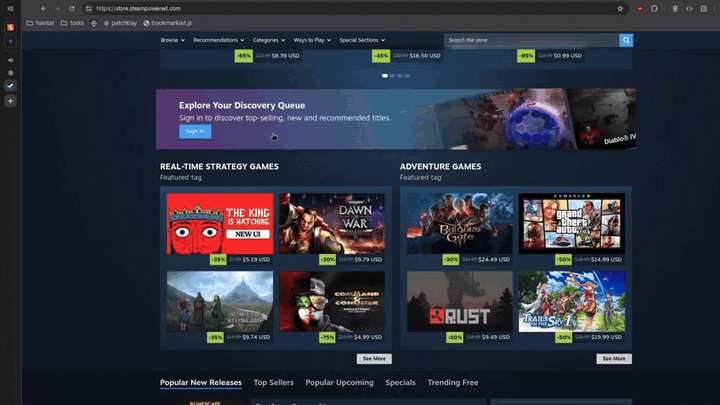
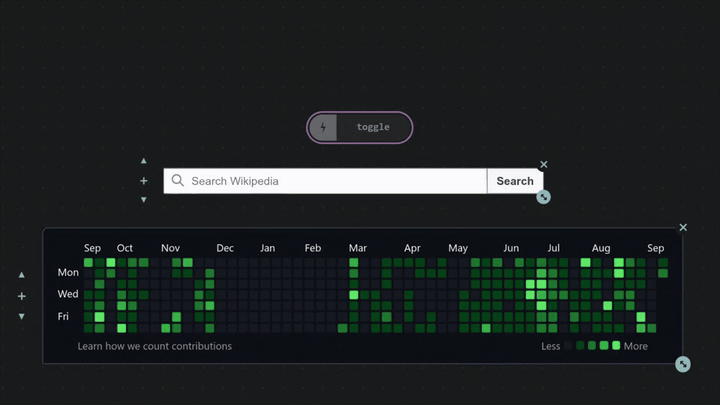
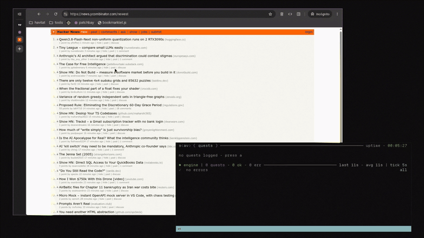

# scav ~ substrate for a portable web

<p align="center">  </p>

```
Harvest anything from the web and wire it into something new
Export it as a single html file, use it anywhere and publish it

UI is a function of state, and in s<av> state is a function of DOM
```

***The whole web is a component repository for your projects - steal a piece, rewire it, keep it forever.***

**scavenger is a substrate for portable web tools.** Anything you build with scav becomes portable by definition, exporting into a single, standalone HTML file that works anywhere. No packages, no build step, no framework, no account, and *nothing phoning home* unless you explicitly want it to.

The toolkit has three core primitives, deliberately different in shape because each is the natural form for what it does. **You don't need all of them to build something**, but together they form the complete project:

[kernel](docs/kernel.md)

The script that you run on any website to harvest components, lift data and run visual debugging tools.

<p align="center">  </p>

Harvesting is not scraping HTML or taking a screenshot. It **takes a rendered component from a live page and reconstructs it** as an independent Web Component: resolving the styles the browser actually applied, preserving the cascade, responsive units, variables, pseudo-elements, fonts, assets, form state, and relevant layout behavior.

[patchbay](docs/patchbay.md)

The runtime, where you place components and wire them, exporting the project as-is into HTML.

<p align="center">  </p>

[quests](docs/quests.md)

The bridge to live external state and data, turning CSS selectors into channels for patchbay to consume.

<p align="center">  </p>

I tried to write the tutorial so five minutes gets you started, but there's a lot to cover. So bear with me - I promise it's worth it:

- Learn the loop with its [quick start](docs/tutorial.md) and bring in live data by harvesting through the [quests](docs/tutorial.md#harvesting-the-web-through-quests) terminal tool
- Extend patchbay by building [nodes and components](docs/tutorial.md#extending-the-patchbay) and set up the [kernel to run anywhere](docs/tutorial.md#running-the-kernel-without-the-bookmarklet)
- Read about the [philosophy](#philosophy) behind the browser as malleable substrate, the [architecture and principles](#architecture-and-principles) or [security](#security)
- For deeper reading, you can find the reference manuals, contract, security and contributing guides [**here**](#full-documentation)

---

## Philosophy

This project starts from a simple premise: **the browser already is a malleable computational substrate.**

The Document Object Model is not just the representation of an interface; it is a live, addressable state space that the browser knows how to render, mutate, serialize, persist and rehydrate. This leads to a simple model: UI is a function of state, and all **persistent state is a function of the DOM.**

```
htmx says "don't maintain a second client-side representation of UI, HTML is the representation"
scav says "don't maintain a second representation of the application, the DOM holds the state"
```

The consequence of this conceptualization is that **the document isn't a rendering of the app, the app is a rehydration of the document.** If state lives in element attributes, values can be serialized into markup, and if the runtime reads the document itself, there is no hidden model to drift out of sync. Saving is a memory dump, the file just boots.

The same property that makes state serialization possible also makes the runtime web **a material you can build from**. The early web itself was built around documents that could be linked, copied, saved, edited and served without asking permission from a platform.

This is still true. The underlying model hasn't changed, but **layers of tooling and growing complexity have obscured it.** We stopped noticing - scav makes those properties apparent and directly usable. What gets distributed to your machine is yours to harvest, rewire and repurpose, and what you build with it can persist as a document.

The modern browser is the closest working approximation of the conceptual model The Memex imagined, Engelbart demoed, and Nelson spent a lifetime writing about: hypertext you author, not just consume. scavenger is less of an invention than a realization that the model is **already here**, installed on almost every personal computer.

The long argument lives in a companion essay - *Artesanías del Runtime* - on the browser as a scavengeable runtime and **the third domain** of tools that only exist there: not CLI, not web app, but local-first visual runtime. (Forthcoming.)

## Architecture and Principles

scavenger is **feature-frozen** except for bugfixes and portability fixes. New capabilities land as new external files and tools, never as changes to the core toolkit. The main laws that keep the architecture intact are:

- **Zero dependencies, build-step or framework.** Each file is native JS and only needs a browser (or node for quests)
- Patchbay's **runtime has a one-way relationship with studio** and never references editing so publish can remove it
- Persistent state is a function of the DOM and serializes into the final file; read more on the philosophy section

The pieces talk through two planes. The clipboard carries a harvest at build time, so the kernel and the patchbay **never hold a live connection to each other.** Channels carry signal at runtime, a value emitted on a channel reaches every receiver wired to it. This routes as a patch locally in the DOM, or as a topic with a network backplane through quests.mjs, allowing the signal to cross between entirely separate dashboards.

The full working guide is in **[contributing](docs/CONTRIBUTING.md)**

## Security

**A patchbay is a program.** An exported HTML or node can run arbitrary JavaScript, so treat one you didn't write like you would a downloaded executable. Never add a node you don't trust, and especially **never swap out the quests.mjs engine** that runs your quests.

The only exception for the *nothing phoning home* rule is a visible `<iframe>`, which is not purged since it holds content you chose to carry. Embeds without visual content are **fully purged**, so if you want a fully sealed patchbay, don't harvest embeds you can see.

The quest server **refuses reads from other websites and writes from anyone but the owner** - with one exception, [a page that hides its origin](docs/security.md). Writes only come from a direct loopback connection, so the boundary is physical, not a capability - and outbound fetches refuse any host resolving to a private address, making it DNS-rebinding-safe.

The complete model is detailed in **[security](docs/security.md)**

## Full Documentation

| Manual | What it covers |
|--------|----------------|
| [Tutorial](docs/tutorial.md) | The quick start, quests, extending the patchbay and running the kernel anywhere |
| [Kernel](docs/kernel.md) | The full tool suite the bookmarklet drops onto any live page |
| [Patchbay](docs/patchbay.md) | Editing gestures, wiring rules, action verbs and logic nodes |
| [Quests](docs/quests.md) | Scraping, the TUI, quests-as-tests, steps and live components |
| [Authoring](docs/authoring.md) | Writing custom logic nodes and components as plain `.html` files |
| [Security](docs/security.md) | The write-gate, SSRF pinning, profile modes and live-emit |
| [Contract](docs/contract.md) | The stable embed/extend boundary - what's frozen from 2.0 |
| [Contributing](docs/CONTRIBUTING.md) | Working on scavenger - the 21-tier testing suite, the laws |
| [Examples](examples) | A curated library of ready-made nodes, components and tools |

## License & Credits

Use it however you like, including commercially and in closed-source projects. **Linking this repo is much appreciated,** the [Apache License 2.0](LICENSE) is here for protection, not restriction.

`s<av>` - built by [@octantes](https://github.com/octantes)