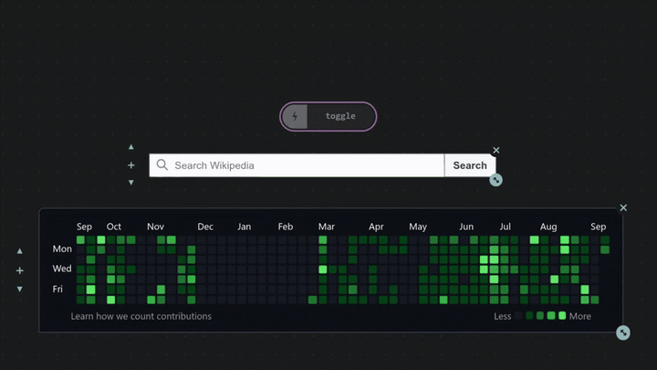
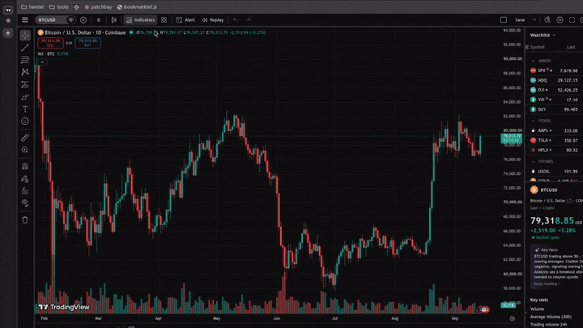
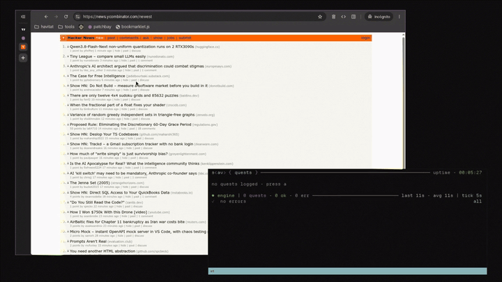
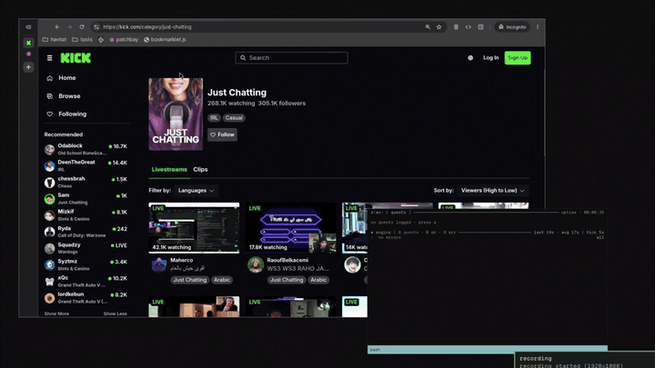

# Tutorial

I strongly recommend downloading the HTML files and actually going through these steps. You'll get a much better understanding of what scav can do from **five minutes of playing with it** than from anything I can write here.

1. Launch `patchbay.html` in your browser (needs a 2024 onward version) by double-clicking it or through `file://`
2. Use the right-click menu or keybinds to spawn nodes, wire them and toggle between use and edit modes

<p align="center">  </p>

3. Create a bookmark from `bookmarklet.js` by pasting the code into the URL field. Ask an AI if it's safe if you want.
4. Run it on a site that doesn't block it (or check [how to run it anywhere](#running-the-kernel-without-the-bookmarklet)) and **harvest something cool looking**
5. If you used the normal harvest, the component is now in your clipboard! Paste it onto the patchbay (`Ctrl + V`)

<p align="center">  </p>

6. Wire nodes, chain multiple components, and play with them - **anything harvested is yours forever**, even offline!
7. You have to **export to save**: `Ctrl + S` keeps editor, `Ctrl + P` exports as document and `Ctrl + I` as a canvas
8. You are all set! Go build something interesting, or keep reading to find out how to bring in live website data

A few things worth knowing:

- If you ever want to give a published export its editing capabilities back, just drop it into a clean patchbay!
- The `clock` node is your best friend: it emits a pulse, which is read by other nodes as **an act-now instruction**
- You can open a node with `Ctrl` + double click or `Enter`, which shows its input value (`clock` input is `interval`)
- All nodes do something when you click their icons, **experiment!** Left click fires them, right click switches their mode

## Harvesting the web through quests

You just learned how to harvest component snapshots, but *what if you want to make those components feel alive?*

Nodes are a way to make them interactive, but you can also **bring in live data from the web** and chain it through wires by using `quests.mjs`. You only need to have `node` installed (which you probably already do), no other dependencies.

1. Open **your terminal** and go to the scavenger directory, then run `node quests.mjs` to open the TUI (`?` for help)
2. Run the bookmarklet on any site, press `quest selector`, and click any single piece of data (like a text or number)
3. Your clipboard has a *pointer to the data you sniped* built from its selector - add a quests node to the patchbay
4. Paste that pointer into the node's input (you can open this and any node with `Ctrl` + double click)
5. Wait for a moment while the engine scrapes the live data, you'll see the quest appear in the terminal interface
6. When data is scraped, the node will emit the quest's **last known value** once - wire a clock so it pulls on interval
7. Now create a node chain to transform the value, or wire it to a harvested component to display it - it will update
8. You can emit values from the patchbay to quests by using a `quest output` node (right click the icon to switch mode)

```
You can skip the snipe and write the line yourself, its shape is: channel-name, url, target
The target can be sel: for a DOM value, key: for a JSON key, or ls: for a localStorage key

An API example: btc, https://api.binance.com/api/v3/ticker/price?symbol=BTCUSDT, key:price
```

<p align="center">  </p>

That's the whole loop, though there is another, more interesting quest type. You can set it up by right clicking a quest node until its label reads `quest component`. Then, you follow the same steps as in the input node, but instead of choosing the selector for a single piece of data, you can select a full component or layout, and paste that line into the node.

After the node is set up, the quests engine will use the bookmarklet to harvest the live version of whatever you selected, and create a **new component that also live-updates**. You can **wire anything into it or through it, like you do with your own harvests**, because the updates are applied via *diff-morphing*, which only updates what really changed. The wires survive because the component is not being re-rendered on each poll.

<p align="center">  </p>

Live data will keep flowing until you close the terminal. When you do that, the quest nodes and components will keep working with their **last known value**. Also, quests will break if the page owner changes the layout of the page or makes a big update that touches the selectors. Keep that in mind.

Some other things quests can do:

- Optionally **drive the page** with steps before reading a value (click, scroll, type, drag) so you can reach behind walls
- By default, quests uses a temp profile, but you can set it up to **harvest login walled sources** with cookie profile
- Normal quests replace their value on update, but log mode keeps historic data to **allow visualization and charts**
- Drive **CI testing** with assertions through the terminal by using --run like the suite that tests scavenger itself does

## Extending the patchbay

Nodes and components are plain `.html` files that can be written anywhere - see [authoring](authoring.md) and start from `examples/template.html`.

1. Write a component as `<template data-scv-comp="name">` holding markup and `<script>` + `<style>` blocks
2. Or write a node as `<script type="scv/node" data-scv-node> defineNode({ ... }) </script>`
3. Drop the file on your patchbay to register it and place the first instance
4. Drop a new version of the same file and every placed instance updates, keeping its data and wiring

Unlike harvested components (rebuilt from markup, with their scripts dropped), authored components keep their scripts: treat files you didn't write like programs you run. `examples/` holds a set of ready to use components, nodes and tools (including charts, visual and audio components that showcase what can be done in the patchbay using WebAPIs).

## Running the kernel without the bookmarklet

The bookmarklet is the browser's `.sh`, an inlined JS script you store to fire easily at any page.

It runs on nearly every site, but a strict Content-Security-Policy still blocks parts of it - that's the browser working as designed, not a bug. Where that happens, you can still run the tool in two ways, no extension needed:

- **One-shot:** Open DevTools with `F12` and paste the contents of `kernel.js` in the console, then hit `Enter`
- **Reusable:** Open DevTools with `F12` and go to `Sources` > `Snippets` > `New Snippet` > paste `kernel.js` > `Save`

Once set up, the snippet will run on any page by right clicking it and pressing `Run`. Console and Snippet runs are user-initiated, so the page's security policy can't stop them from running.